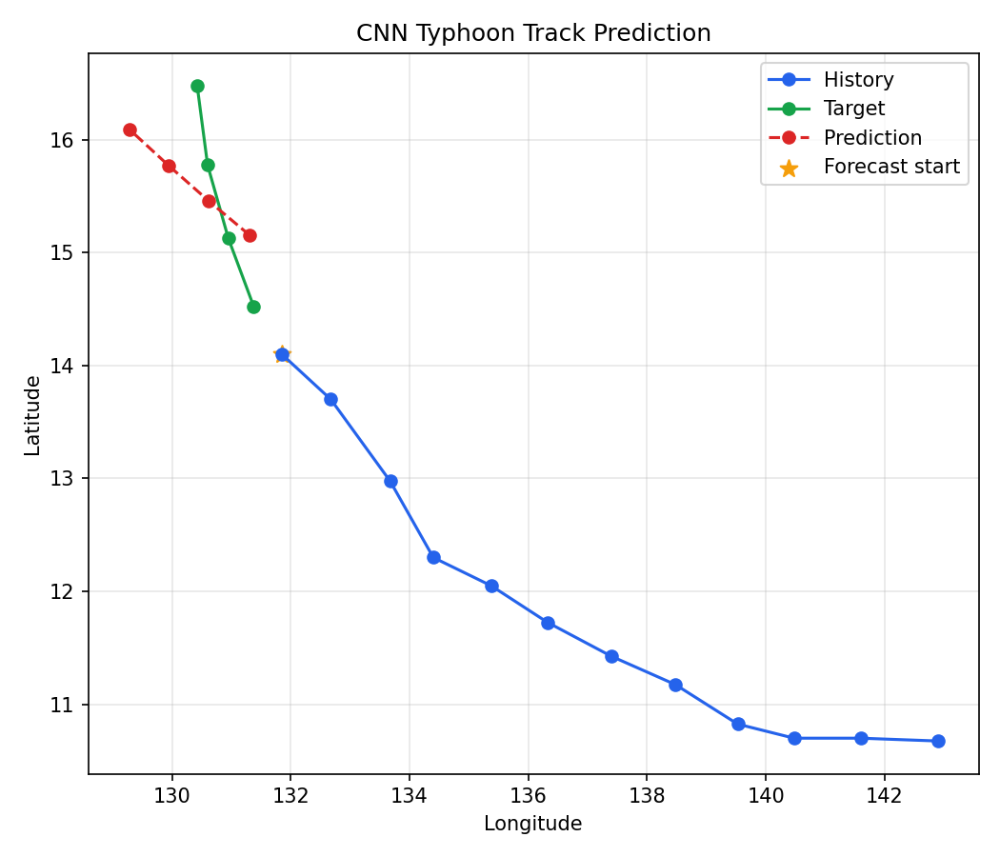
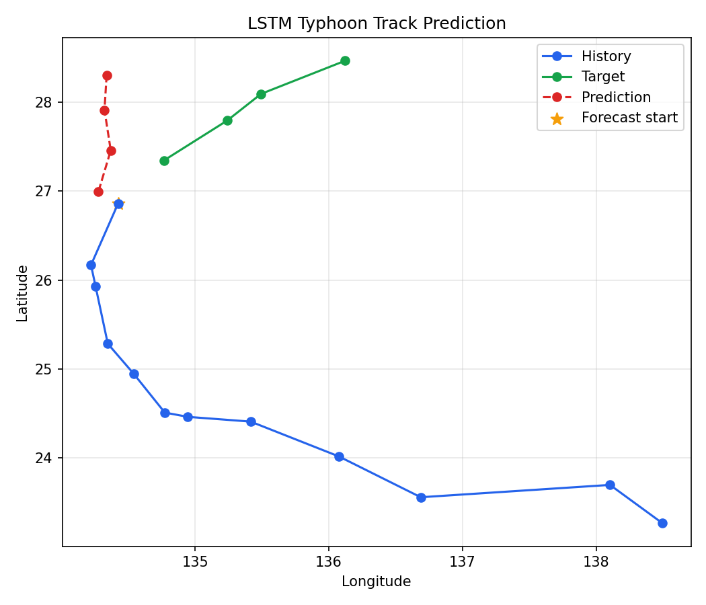
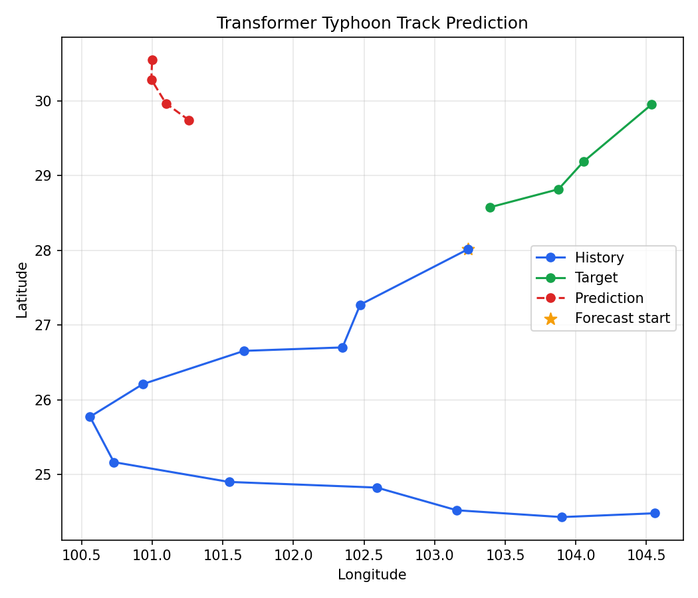
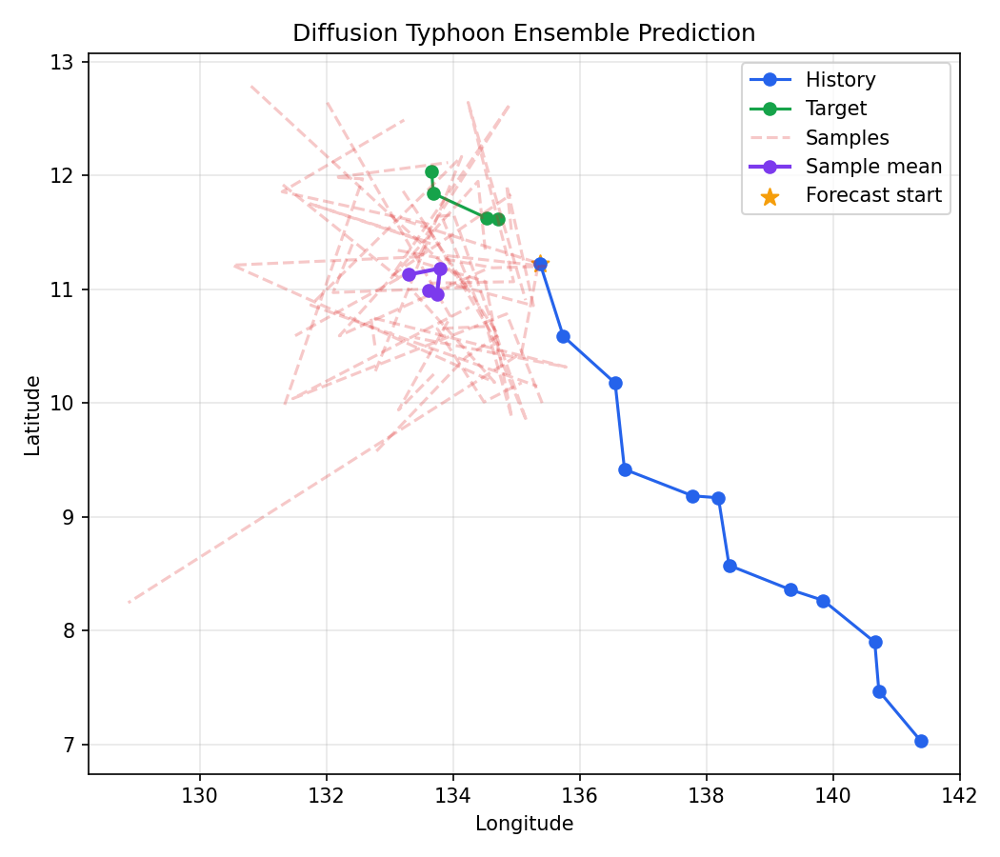
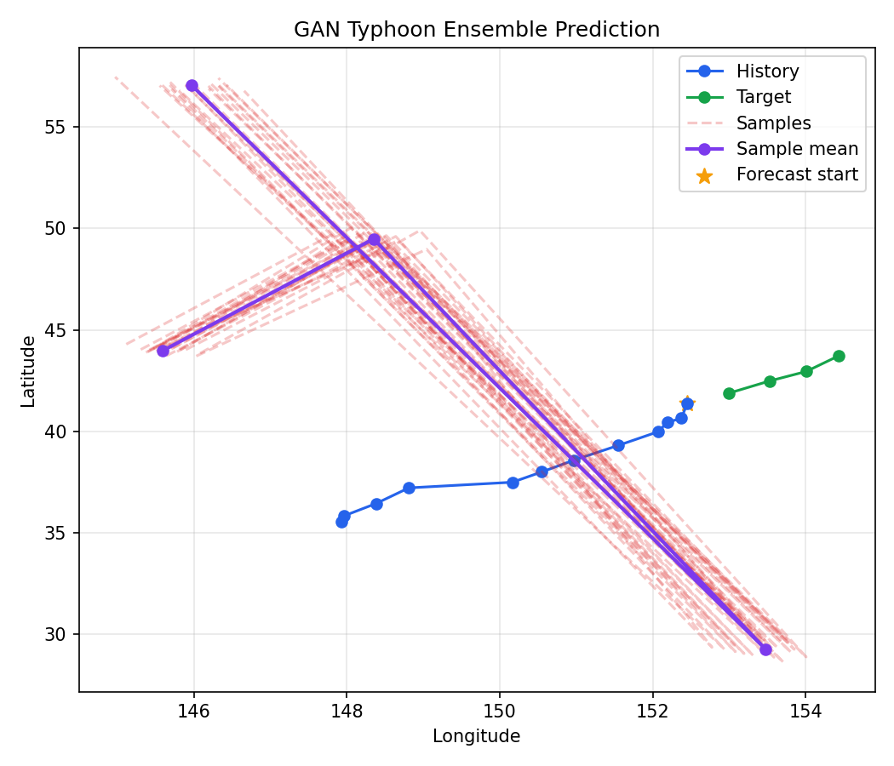
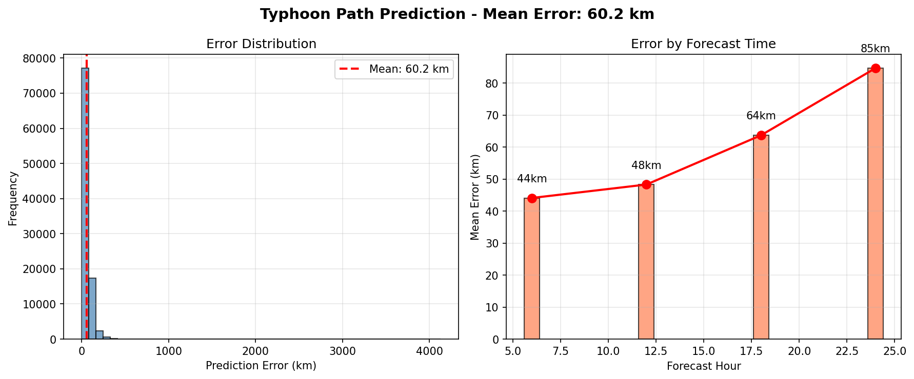

# Typhoon Trajectory Prediction Using Deep Learning

A comparative study of deep learning approaches for tropical cyclone trajectory forecasting using historical IBTrACS data.

## Overview

This project investigates deep learning methods for predicting tropical cyclone trajectories in the Western Pacific basin.

Five baseline architectures are evaluated alongside an improved Stacked LSTM model developed as the main contribution of this project.

The objective is to predict future typhoon center positions using historical latitude and longitude observations.

## Research Objectives

- Evaluate different deep learning architectures for typhoon trajectory prediction.
- Compare temporal, spatial, attention-based and generative approaches.
- Develop an improved LSTM architecture for multi-step trajectory forecasting.
- Evaluate prediction performance using Haversine distance.

## Dataset

**Dataset:** IBTrACS (International Best Track Archive for Climate Stewardship), version v04r00.

- Region: Western Pacific basin
- Input sequence: 72 hours (12 time steps)
- Prediction horizon: 24 hours (4 time steps)
- Sampling interval: 6 hours
- Input features: Latitude and longitude

The dataset was filtered geographically and normalized before training.

The original dataset is not included in this repository. Refer to `DATA_GUIDE.md` for dataset preparation instructions.

## Models

### 1. Baseline Models

The following baseline implementations were provided through the original Smart Weather Deep Learning project and used for comparative experiments:

| Model | Architecture |
|---|---|
| CNN | 1D Convolutional Neural Network |
| LSTM | Seq2Seq with Bahdanau Attention |
| Transformer | Self-Attention and Positional Encoding |
| Diffusion | Conditional DDPM |
| GAN | WGAN-GP |

Original project: https://github.com/hugo-xie/smart-weather-dl

### 2. Proposed Model – Improved Stacked LSTM

The main contribution of this project is an improved LSTM-based model designed for direct multi-step typhoon trajectory prediction.

**Architecture specifications:**

- 3 stacked LSTM layers
- 256 hidden units
- Dropout: 0.2
- Historical input: 72 hours
- Forecast horizon: 24 hours
- Output: 4 future positions

The model uses a direct prediction strategy to generate multiple future positions rather than predicting one step at a time.

## Experimental Results

The following values are reported in the project experiment report.

### Model Comparison

| Model | Reported mean error (km) |
|---|---:|
| Improved Stacked LSTM | 60.2 |
| Baseline LSTM | 81 |
| Diffusion | 118 |
| CNN | 135 |
| Transformer | 205 |
| GAN | 1,160 |

Note: The 60.2 km value is reported as the mean across the four forecast horizons. The 24-hour endpoint error is reported separately as 84.7 km. Evaluation protocols should be verified for strict cross-model comparability.

### Improved LSTM: Error by Forecast Horizon

| Forecast horizon | Mean error (km) |
|---|---:|
| 6 hours | 44.1 |
| 12 hours | 48.3 |
| 18 hours | 63.7 |
| 24 hours | 84.7 |

Evaluation metric: Haversine distance, measured in kilometres.

## Visual Results

Prediction visualizations generated during the experiments are available in the `results/` directory.

### CNN


### LSTM


### Transformer


### Diffusion


### GAN


### Additional Results


## Technologies Used

- Python
- PyTorch
- NumPy
- Pandas
- Matplotlib
- Scikit-learn
- Deep Learning
- Time Series Forecasting

## Repository Structure

```text
typhoon-trajectory-prediction/
│
├── better_model.py
├── typhoon_cnn.py
├── typhoon_diffusion.py
├── typhoon_gan.py
├── typhoon_lstm.py
├── typhoon_transformer.py
├── typhoon_utils.py
│
├── results/
│   ├── typhoon_cnn_prediction.png
│   ├── typhoon_diffusion_prediction.png
│   ├── typhoon_gan_prediction.png
│   ├── typhoon_lstm_prediction.png
│   ├── typhoon_transformer_prediction.png
│   └── typhoon_simple_results.png
│
├── DATA_GUIDE.md
├── requirements.txt
├── .gitignore
└── README.md
```

## Installation

Clone the repository:

```bash
git clone https://github.com/benzidankhaoula/typhoon-trajectory-prediction.git
cd typhoon-trajectory-prediction
```

Install dependencies:

```bash
pip install -r requirements.txt
```

Download and prepare the IBTrACS dataset according to `DATA_GUIDE.md`.

Configure the dataset path before running the training scripts.

## Limitations and Future Work

Current limitations include:

- Reliance on latitude and longitude as input features.
- Geographic restriction to the Western Pacific basin.
- Deterministic predictions without uncertainty estimation.
- Further evaluation and hyperparameter optimization are needed.

Potential future improvements:

- Incorporating wind speed and atmospheric pressure.
- Adding environmental features such as sea surface temperature.
- Exploring uncertainty-aware forecasting.
- Testing generalization across different ocean basins.
- Improving evaluation through storm-level data splitting.

## Acknowledgements

The baseline implementations used in this comparative study originate from the Smart Weather Deep Learning project by Hugo Xie.

The improved Stacked LSTM implementation and experiments are part of my work in the Smart Meteorology course.

## Author

**Khaoula Benzidan**

Artificial Intelligence Undergraduate Student

Nanjing University of Information Science and Technology (NUIST)

Research interests: Artificial Intelligence, Deep Learning, Machine Learning and Weather Forecasting.
